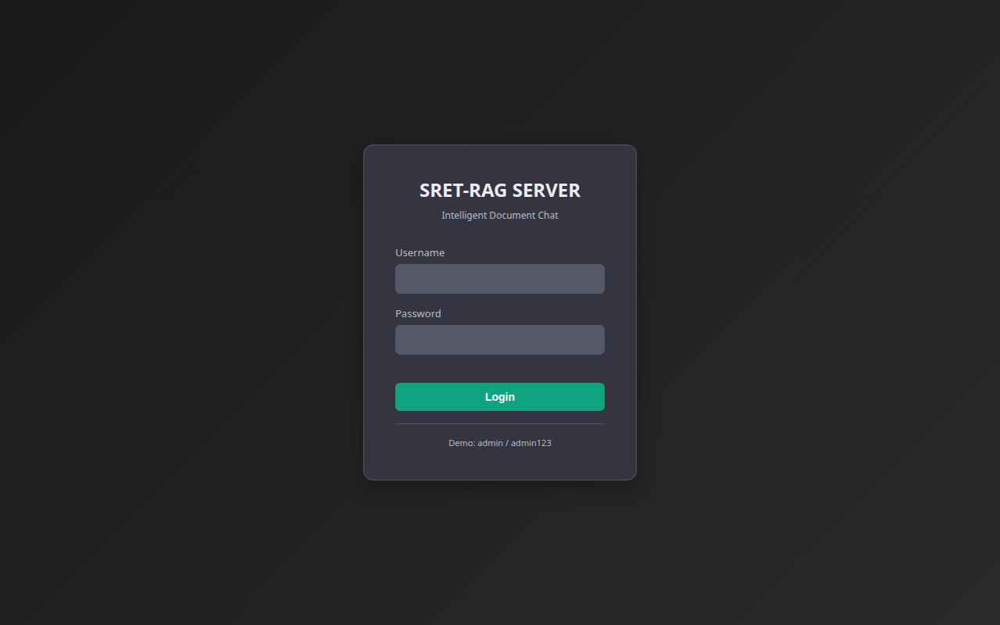
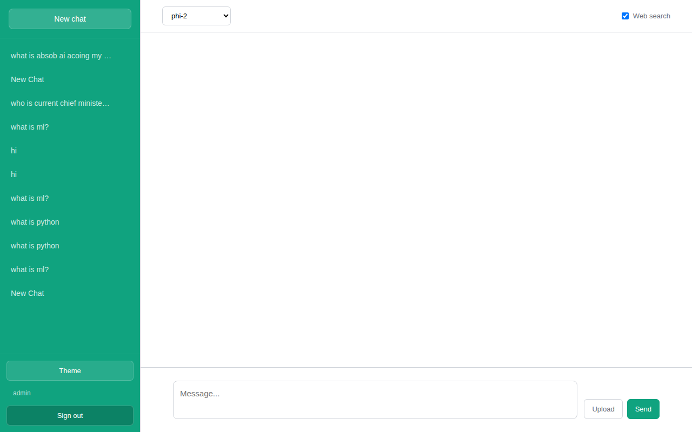

# sret-rag

> **Self-hosted Retrieval-Augmented Generation** — fully offline, 4-PC LAN cluster, ChatGPT-style UI, no cloud required.

[](LICENSE)
[](https://www.python.org/)
[](https://fastapi.tiangolo.com/)

---

## What is this?

`sret-rag` turns 4 budget PCs (Intel i3, 8 GB RAM, 200 GB HDD) into a private AI document chat system.  
Upload PDFs or text files → ask questions → get cited answers. Everything runs on your LAN, zero internet dependency after setup.

---

## Screenshots

| Login | Chat |
|-------|------|
|  |  |

---

## Architecture

```
PC1 (192.168.1.10:8000)   ←  FastAPI Gateway + Web UI (ChatGPT-style)
PC2 (192.168.1.11:8001)   ←  Embedder (all-MiniLM-L6-v2, 384-dim)
PC3 (192.168.1.12:8002)   ←  FAISS Index (IVF50,PQ8) + SQLite metadata
PC4 (192.168.1.13:8003)   ←  LLM Server (llama.cpp + Qwen2.5 7B Q4_K_M)
```

Each node is a plain Linux machine. No GPU required — uses Intel Iris Xe iGPU via llama.cpp SYCL.

---

## Features

- **Fully offline** — works without internet after initial setup
- **ChatGPT-style UI** — dark theme, chat history, model switcher, file upload
- **Multi-model** — switch between phi-2, Qwen2.5-1.5B, TinyLlama-1.1B at runtime
- **RAG pipeline** — PDF/DOCX/TXT → semantic chunking → FAISS vector search → cited answers
- **Embed cache** — SHA256-keyed SQLite cache; zero re-embedding for duplicate chunks
- **Doc dedup** — SHA256(file bytes) skip re-ingestion of already-indexed docs
- **Auth** — session-based login, admin panel, user management
- **Async everywhere** — FastAPI + aiosqlite + asyncio; C extensions in ThreadPoolExecutor
- **zram** — 3 GB lz4 swap on all nodes to stretch 8 GB RAM

---

## Stack

| Layer | Tech |
|-------|------|
| API | FastAPI + uvicorn |
| UI | Custom HTML/JS (ChatGPT-replica) |
| PDF parse | PyMuPDF (fitz) |
| Chunking | semantic-text-splitter (BERT-boundary, 512 tokens) |
| Embeddings | all-MiniLM-L6-v2 via sentence-transformers |
| Vector DB | FAISS IVF50,PQ8 — dim=384, nprobe=5 |
| Metadata | SQLite via aiosqlite |
| LLM | llama.cpp server — Qwen2.5 7B Q4_K_M |
| Auth | python-jose JWT + bcrypt |

---

## Hardware Requirements

- 4× PC with Intel i3 (11th Gen recommended), 8 GB RAM, 200 GB HDD
- Linux (Ubuntu/Mint)
- LAN with static IPs (192.168.1.10–13)
- No GPU required

---

## Quick Start

### 1. Setup (all PCs, one time)

```bash
# Copy from USB
sudo rsync -avh /media/$USER/*/offline_rag/ ~/rag/

# Python env
cd ~/rag
python3 -m venv venv
source venv/bin/activate
pip install --no-index --find-links=./wheels \
    torch sentence-transformers faiss-cpu \
    fastapi uvicorn httpx python-multipart PyMuPDF tqdm
```

### 2. Start cluster (from PC1)

```bash
bash scripts/start_cluster.sh
```

> Starts PC2/PC3/PC4 via SSH, then launches PC1 gateway.  
> Open browser: `http://192.168.1.10:8000`  
> Default login: `admin` / `admin123` (**change in `.env`**)

### 3. Index documents

```bash
# Place PDFs in docs/
mkdir -p ~/rag/docs && cp /path/to/*.pdf ~/rag/docs/

# Process + index (PC3)
source venv/bin/activate
python3 pc3_process_docs.py --input ~/rag/docs --output chunks.txt
python3 build_index.py
```

### 4. Stop

```bash
bash scripts/stop_cluster.sh
```

---

## Manual node startup (order matters)

```bash
# 1. All PCs
bash scripts/setup_zram.sh

# 2. PC4 (wait 45s for model load)
bash scripts/start_llm.sh

# 3. PC3, PC2, PC1
bash scripts/setup_pc3.sh
bash scripts/setup_pc2.sh
bash scripts/setup_pc1.sh
```

---

## API Reference

```
POST /api/v1/ingest/file       →  {doc_id, status, chunks}
POST /api/v1/ingest/url        →  {doc_id, status, chunks}
POST /api/v1/query             →  {answer, sources[], latency_ms}
POST /v1/chat/completions      →  OpenAI-compatible (stream supported)
GET  /api/v1/health            →  {status, index_ready, model}
```

PC4 (llama.cpp) also exposes `/completion` and `/v1/chat/completions` directly.

---

## Project Structure

```
offline_rag/
├── rag_server/          # PC1 — FastAPI gateway + web UI
│   ├── api/routes/      # ingest, query, auth, admin, chat, search
│   ├── core/            # config (pydantic-settings), database, auth
│   ├── ingestion/       # parser (PyMuPDF), chunker (semantic-text-splitter)
│   ├── retrieval/       # embedder (MiniLM), vector_store (FAISS)
│   ├── generation/      # llm_client (httpx→PC4), prompt_builder
│   ├── workers/         # ingest_worker (async pipeline)
│   └── static/          # index.html, app.html, admin.html, app.js, style.css
├── pc2_embed/           # PC2 — standalone embedder server
├── pc3_index/           # PC3 — FAISS index + SQLite store
├── scripts/             # cluster management scripts
├── models/              # GGUF model files
├── llama.cpp/           # local llama.cpp build
├── storage/             # faiss.index + metadata.db + uploads/
├── wheels/              # offline Python packages (pip --find-links)
├── debs/                # offline Debian packages
└── docs/screenshots/    # UI screenshots
```

---

## Security Notes

- Change `secret_key`, `admin_password` in `.env` before first use
- `.env` is never committed
- Cloudflare Tunnel credentials (`~/.cloudflared/*.json`) are never logged or read
- Default `admin/admin123` is for local LAN only — rotate before any public exposure

---

## License

MIT — see [LICENSE](LICENSE)

---

## Author

**Jeyadev R** · AI/ML Engineer & Full-Stack Developer · Chennai, India

- Portfolio: [jeyadev.dev](https://jeyadev.dev/projects/sret-rag)
- GitHub: [@jeyadev-jd](https://github.com/jeyadev-jd)
- LinkedIn: [r-jeyadev](https://www.linkedin.com/in/r-jeyadev)

If this project is useful to you, a ⭐ on the repo helps others find it.
